<p align="center">
  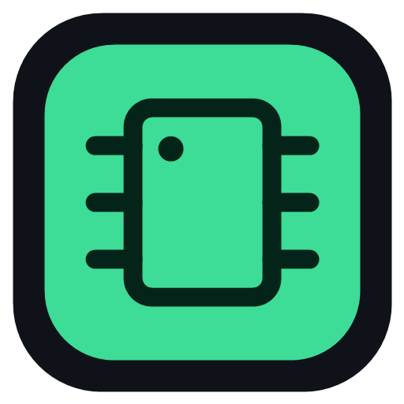
</p>

<h1 align="center">BiosFlash Studio</h1>

<p align="center">
  <b>A modern CH341A BIOS programmer with firmware repair tools — for Windows, Debian/Ubuntu and Fedora.</b><br>
  Read, write and verify SPI flash and I²C EEPROM chips, analyze Intel/AMD firmware, repair dumps from stock images,
  unpack vendor BIOS updates and change the boot logo safely.
</p>

<p align="center">
  
  
  
  
  
  
</p>

<p align="center">
  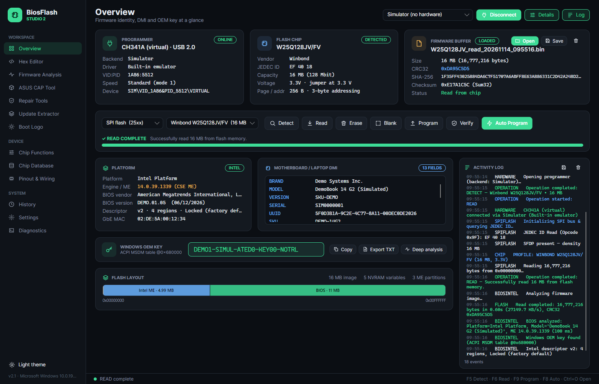
</p>

---

## Contents

- [Highlights](#highlights)
- [Feature tour](#feature-tour)
  - [Programmer dashboard](#1-programmer-dashboard) · [Hex editor](#2-hex-editor) · [Firmware analysis](#3-firmware-analysis)
  - [Boot logo editor](#4-boot-logo-editor) · [Repair tools](#5-repair-tools) · [Update extractor](#6-update-extractor) · [ASUS CAP tool](#7-asus-cap-tool)
  - [Chip functions](#8-chip-functions) · [Chip database](#9-chip-database) · [Pinout & wiring](#10-pinout--wiring)
  - [History & settings](#11-history--settings) · [Diagnostics & Linux](#12-diagnostics--linux) · [Light & dark themes](#13-light--dark-themes)
- [Download & install](#download--install)
- [Connecting a CH341A](#connecting-a-ch341a)
- [Building from source](#building-from-source)
- [Testing](#testing)
- [Project layout](#project-layout)
- [Safety](#safety)
- [License](#license)

## Highlights

- **One app on three platforms.** Native installers for Windows, Debian/Ubuntu and Fedora/RHEL, each with the .NET runtime bundled.
- **CH341A done properly.** It works through the WCH vendor driver or WinUSB (Zadig) on Windows and through libusb on Linux, and picks the backend automatically. Chips are auto-detected by JEDEC ID, with an SFDP size cross-check and 4-byte addressing for 32 MB+ chips. Smart write only rewrites the 4 KB sectors that changed.
- **Firmware forensics.** It shows the Intel descriptor regions, ME/CSE version, DMI serial and UUID, the Windows OEM key, the GbE MAC, NVRAM variables and the AMD PSP.
- **Boot logo editor.** Find the logo, even inside LZMA- or EFI/Tiano-compressed sections (AMI Aptio 4 and V), and replace it. Safety nets make a wrong format, size or colour depth impossible.
- **Repair tools.** Clear NVRAM, clean the ME region, set the MAC, or rebuild a broken BIOS/ME/descriptor from stock firmware. The board's own identity (MAC, serial, OEM key) is carried over from its dump.
- **Update extractor and ASUS CAP tool.** Pull a flashable image out of InsydeFlash `.exe` files, capsules and ZIP downloads.
- **Safe by default.** Every read is backed up automatically. There are optional double reads, verify-after-write, confirmations before destructive steps and undo for every buffer edit.
- **No hardware needed to try it.** A built-in simulator and a synthetic demo firmware (with sample boot logos) let you explore every feature.

## Feature tour

> All screenshots come from the built-in **demo mode** (`--demo`): a simulated CH341A with a synthetic firmware image. No real customer data is shown.

### 1. Programmer dashboard


- **Status cards** for the programmer (backend, driver, speed), the detected chip (vendor, JEDEC ID, capacity, voltage, addressing) and the firmware buffer (size, CRC32, SHA-256, checksum).
- **Operation deck:** Detect, Read, Erase, Blank check, Program, Verify and **Auto Program** (unprotect → erase → blank → program → verify). Each has a keyboard shortcut.
- **Live progress** with speed, elapsed and remaining time, current address, and a colour-coded result badge.
- **Overview page:** platform, ME version, BIOS vendor and version, descriptor status, GbE MAC, the **DMI table** (brand, model, serial, UUID, SKU, board), the **Windows OEM key** with copy/export, and a flash-layout bar.
- **Activity log** with timestamps and colour levels, saved per session. It can be collapsed.

### 2. Hex editor

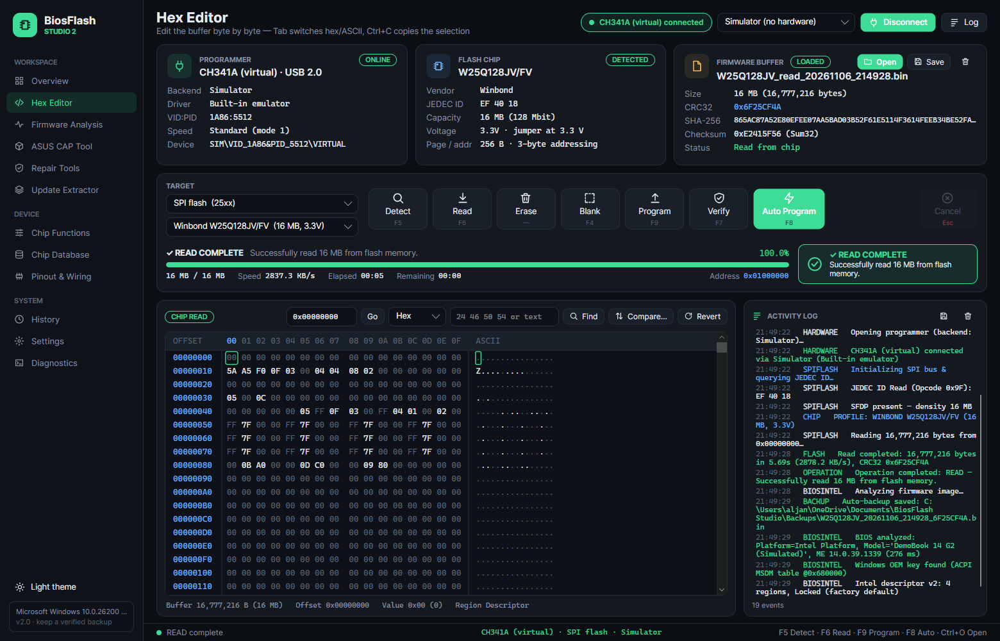

- Virtualized: opens 64 MB+ images instantly. Edit in hex or ASCII (Tab switches between them).
- Search by hex bytes, text or UTF-16; go to an address; compare with a file; revert edits.
- Modified bytes are highlighted, and the status line shows the offset, value, selection and the descriptor region under the cursor.

### 3. Firmware analysis

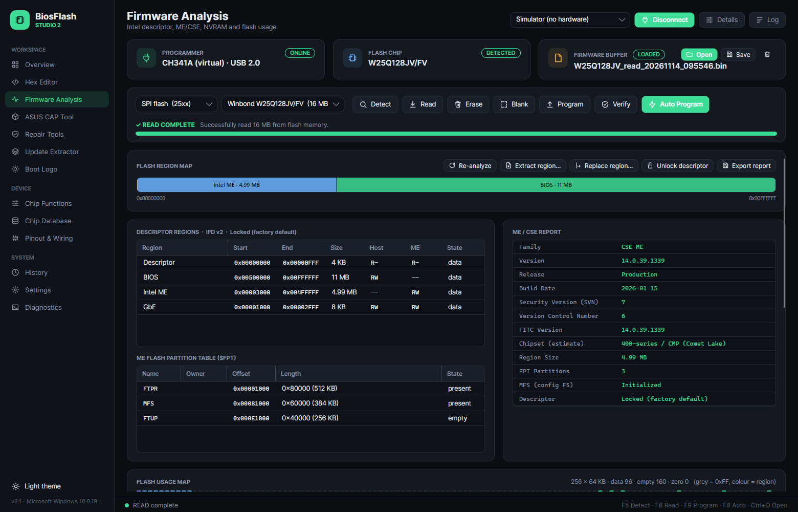

- **Intel flash descriptor** (v1/v2): region map, start/end, size, host and ME access rights, lock state.
- **ME / CSE / TXE report:** version, release type, build date, SVN, VCN, FITC version, chipset estimate, and the `$FPT` partition table.
- **Flash usage map** (per 64 KB block: empty / zero / data, coloured by region) and **UEFI NVRAM** variables (VSS, authenticated VSS, AMI NVAR) with filter and jump-to-hex.
- AMD PSP / AGESA detection, BIOS vendor/version/date, and a full **TXT report** export.
- Region tools: **extract**, **replace** (e.g. a clean ME) and **unlock descriptor**.

### 4. Boot logo editor

<table>
<tr>
<td>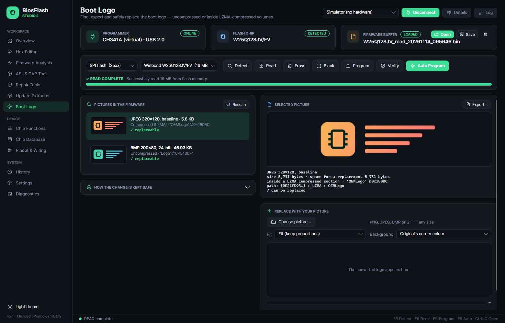</td>
<td>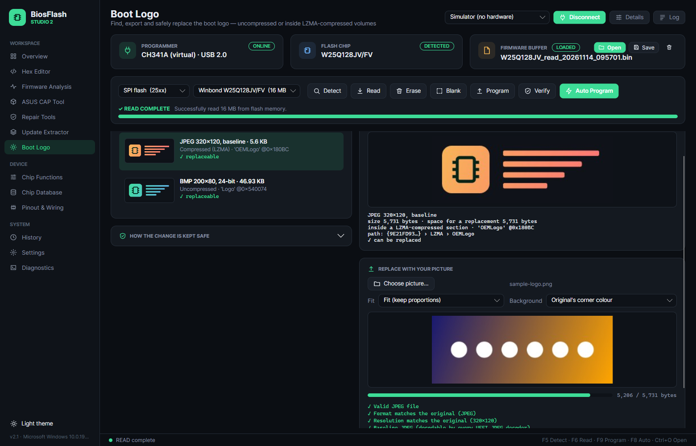</td>
</tr>
<tr>
<td align="center"><sub>Every picture in the firmware, including inside compressed volumes</sub></td>
<td align="center"><sub>Your picture, auto-converted, with a size meter and a checklist</sub></td>
</tr>
</table>

- Finds every **BMP, JPEG, PNG and GIF** in the firmware, including pictures inside **LZMA** and **EFI/Tiano**-compressed UEFI sections (AMI Aptio V and Aptio 4 logos). Shows thumbnail, resolution, colour depth and the full path (file › LZMA › logo file).
- **Export** any picture, or **replace** it with your own (PNG, JPEG, BMP, GIF or WebP, any size).

**Safety nets.** Each one stops a replacement that could keep the board from booting:

| | |
|---|---|
| **Automatic conversion** | Your picture is converted to the *original's* format, resolution and colour depth (BMP 1/4/8/24/32-bit, baseline JPEG, PNG, single-frame GIF). You cannot pick a wrong one |
| **Fit** | Fit, fill (crop) or stretch to the exact logo resolution, with a background colour taken from the original |
| **Size** | The result must fit in the original's space. JPEG quality is lowered automatically; a size meter shows how much space is used |
| **Re-decode** | The converted file is decoded again and its header is validated before it can be used |
| **Rebuild** | Compressed volumes are recompressed as exact-length LZMA streams (checked against the xz and 7-Zip decoders). The freed space becomes a filler section, so no other file moves. EFI/Tiano sections (AMI Aptio 4) are recompressed in place; if the new logo is larger, its file grows into the volume's free space, as AMI's ChangeLogo does. FFS and CRC32 checksums are recomputed |
| **Verification** | The rebuilt firmware is parsed again. Checks: every checksum, every compressed section, the new logo byte-for-byte, and *nothing outside the logo's own file changed*. If any check fails, the buffer is not touched |
| **Protection** | Firmware with **Intel Boot Guard** is blocked unless you explicitly override. Pictures inside code modules or behind unsupported compression (Tiano, Brotli) are export-only |
| **Undo** | Only the buffer changes, so Undo works, and your original dump stays in the backups |

### 5. Repair tools

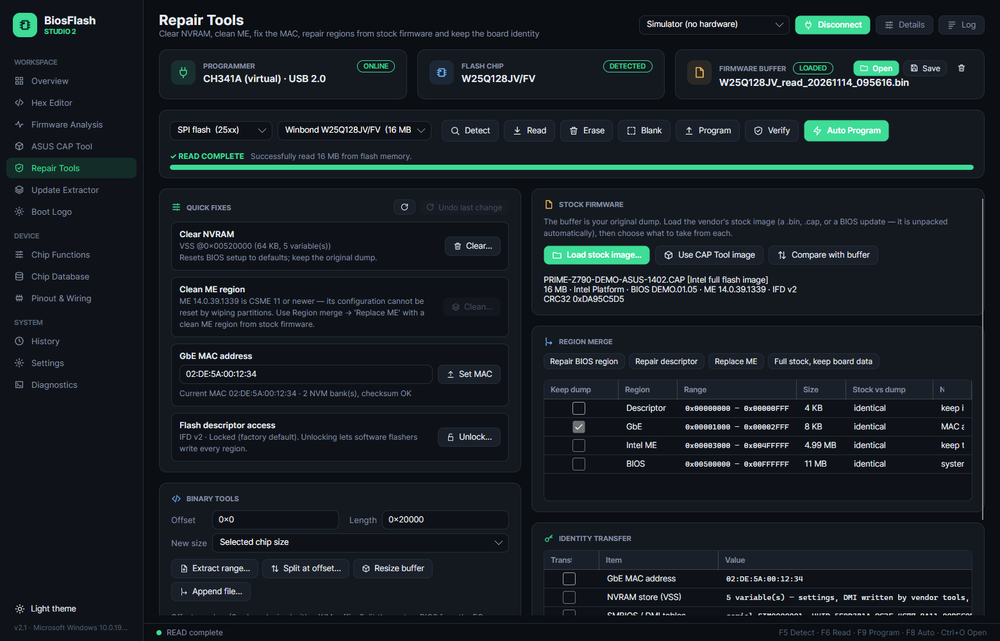

- **Quick fixes on the buffer** (one-step **Undo**):
  - **Clear NVRAM:** resets BIOS settings; store headers are kept.
  - **Clean ME:** wipes MFS/FLOG for ME ≤ 10 and TXE. CSME 11+ is refused and must be replaced from stock.
  - **Set MAC:** writes every Intel GbE NVM bank and fixes the checksum.
  - **Unlock descriptor.**
- **Repair from stock:** load a stock image or a vendor update and merge it with your dump region by region. Presets: *Repair BIOS region*, *Repair descriptor*, *Replace ME*, *Full stock, keep board data*.
- **Identity transfer:** copies the MAC, NVRAM store, SMBIOS serial/UUID tables and MSDM key from the board's own dump into the result, wherever the stock layout allows.
- **Binary tools:** extract a range, split (system BIOS / EC firmware), pad or truncate to a size, append files.

### 6. Update extractor

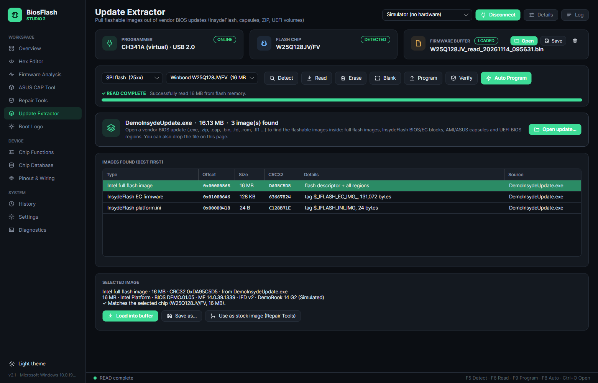

- Open a vendor BIOS update (`.exe`, `.zip`, `.cap`, `.fl1`, `.bin` …) and get the flashable images inside, best first:
  - Intel full-flash images
  - InsydeFlash `$_IFLASH` BIOS / EC / `platform.ini` blocks
  - AMI / ASUS / UEFI capsules
  - BIOS-region-only firmware volume runs
  - ZIP archives, scanned recursively
- Load an image into the buffer, save it, or send it to Repair Tools as the stock image.
- For formats it can't open (Dell PFS, 7-Zip/CAB self-extractors, encrypted HP updates) it explains what the file is and what to do.

### 7. ASUS CAP tool

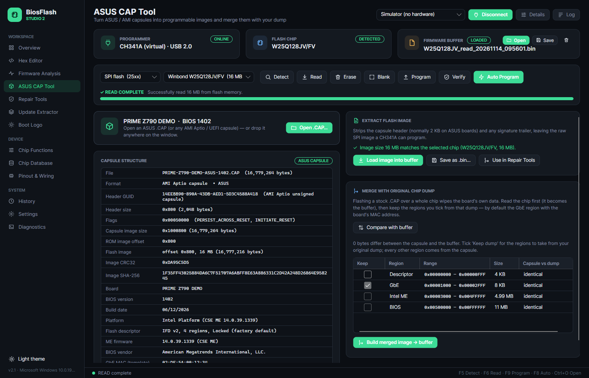

- Parses ASUS / AMI Aptio / UEFI capsules: header GUID, size, flags and signature trailer. The board and BIOS version come from the file name and `$BOOTEFI$`.
- Strips the capsule header and checks the image size against the detected chip.
- **Merges with your original dump** so the board keeps its MAC address (GbE region), and optionally its ME and descriptor.

### 8. Chip functions

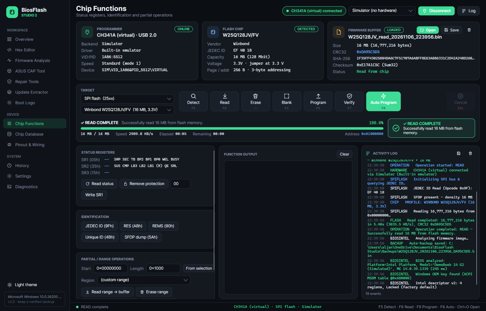

- Status registers SR1/SR2/SR3 with bit decoding, **protection removal** and a raw SR1 write.
- Identification: JEDEC ID, RES, REMS, Unique ID and an SFDP dump.
- **Range operations:** read, erase, write (smart, only changed sectors) or verify any address range or a single descriptor region. For example, flash only the BIOS region.

### 9. Chip database

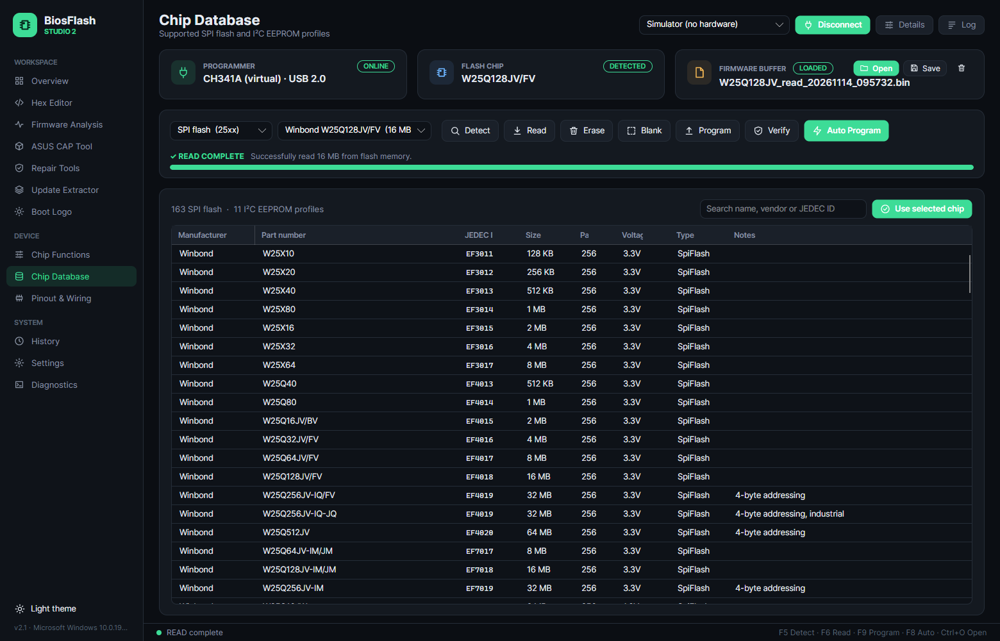

- **160+ SPI NOR profiles**: Winbond, Macronix, GigaDevice, EON, Micron, ISSI, XMC, SST, Spansion, Fudan, Zbit, Boya, Puya, XTX and more.
- **24C01–24C1024 I²C EEPROMs.**
- Search by name, vendor or JEDEC ID, then double-click to use a profile. 1.8 V parts are flagged, and unknown JEDEC IDs fall back to a generic profile sized via SFDP.

### 10. Pinout & wiring

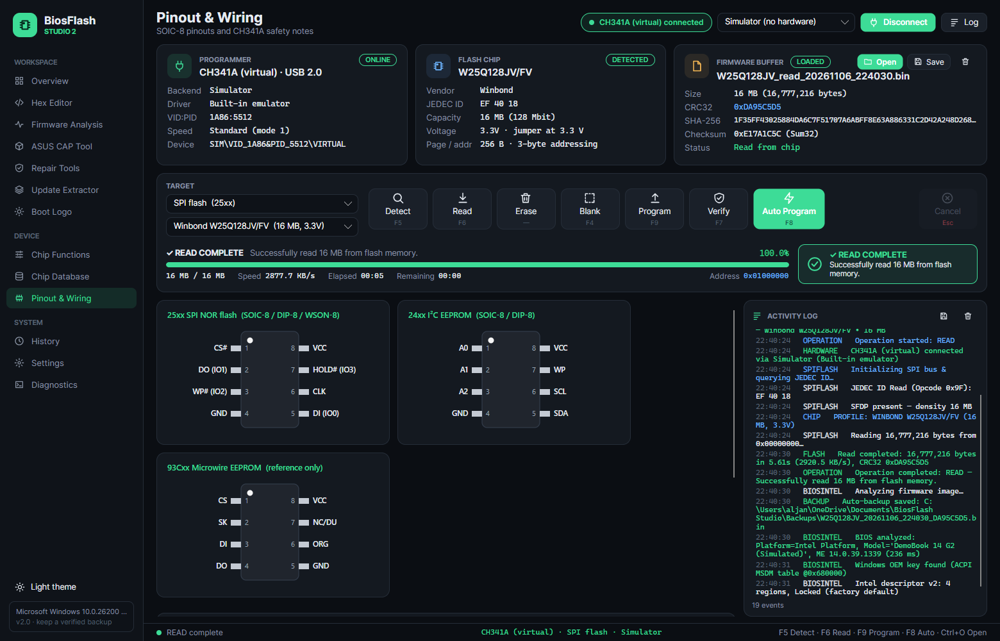

- SOIC-8 / DIP-8 pinouts for 25xx SPI flash, 24xx I²C EEPROM and 93Cxx Microwire.
- CH341A wiring and safety notes: the 5 V data-line issue, 1.8 V adapters, in-circuit clipping, clip contact, backups.

### 11. History & settings

<table>
<tr>
<td>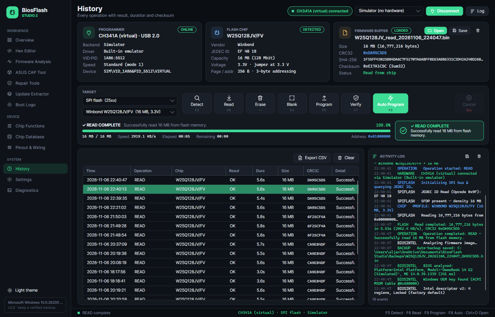</td>
<td>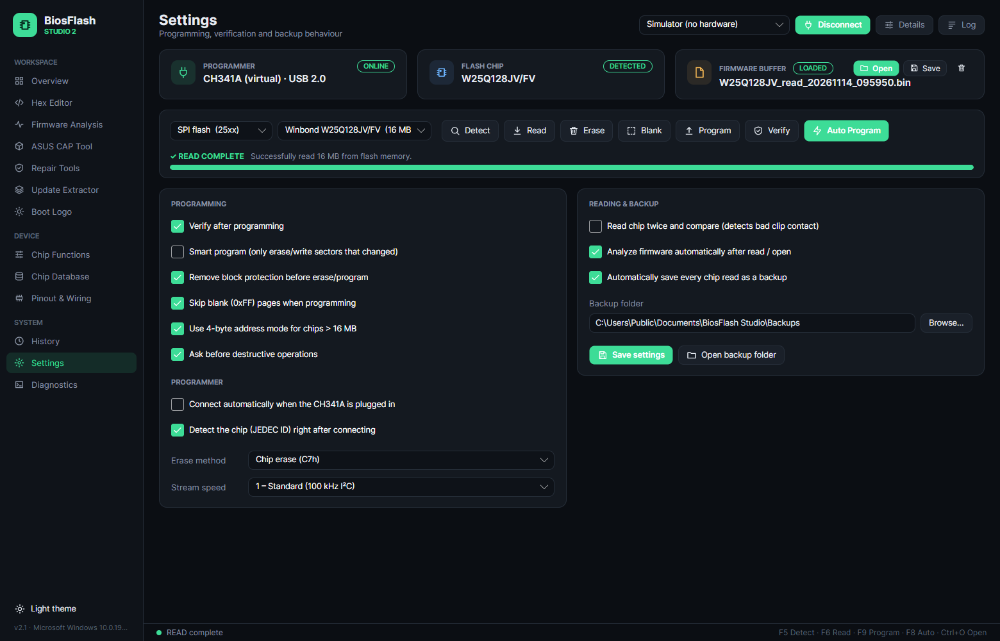</td>
</tr>
</table>

- **History:** every operation with time, chip, result, duration, size and CRC32, exportable as CSV.
- **Settings:**
  - verify after programming, smart program, auto-unprotect, skip blank pages, 4-byte mode
  - confirmations, double read, auto-analyze, auto-backup with a backup folder
  - erase method (chip / block / sector) and stream speed

### 12. Diagnostics & Linux

<table>
<tr>
<td>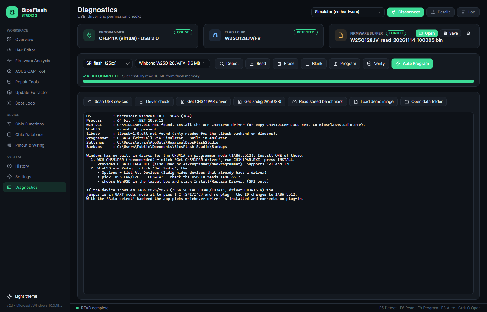</td>
<td>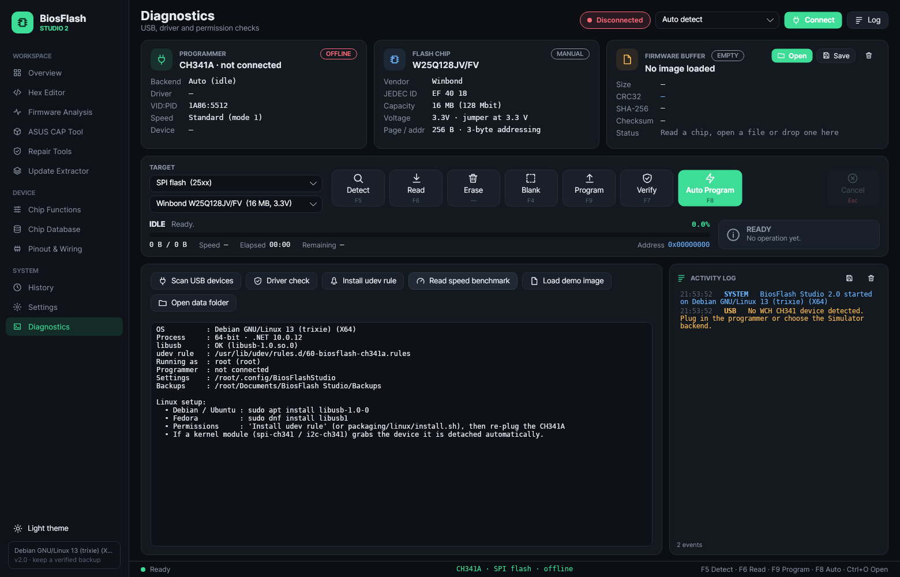</td>
</tr>
<tr>
<td align="center"><sub>Windows: WCH DLL, WinUSB and libusb checks</sub></td>
<td align="center"><sub>Debian 13: libusb, udev rule, permissions</sub></td>
</tr>
</table>

- USB scan of all WCH devices, with driver, access and UART-mode jumper warnings.
- Driver check: WCH DLL / WinUSB on Windows; libusb, udev rule and user on Linux. There's a one-click **Install udev rule** button (pkexec).
- Read-speed benchmark and the demo image loader.

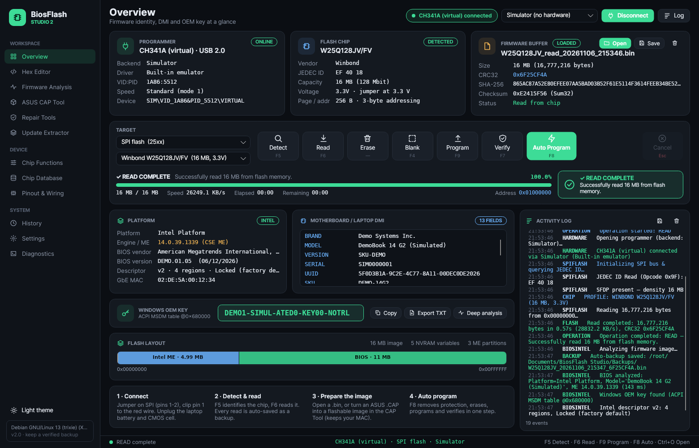

<p align="center"><sub>The same app running natively on Debian 13 (installed from the .deb).</sub></p>

### 13. Light & dark themes

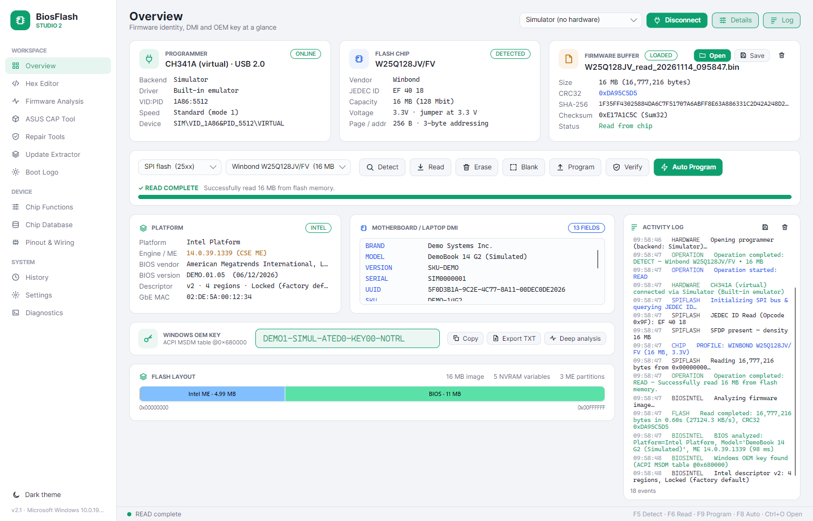

Graphite/mint dark theme and paper/emerald light theme, switchable from the sidebar.

**Keyboard shortcuts:** **F5** Detect · **F6** Read · **F4** Blank · **F9** Program · **F7** Verify · **F8** Auto · **Ctrl+O** Open · **Ctrl+S** Save · **Esc** Cancel

## Download & install

Get the file for your system from the **[Releases](../../releases)** page.

| System | File | Install |
|---|---|---|
| **Windows 10/11 (x64)** | `BiosFlashStudio-2.1.0-win-x64-setup.exe` | Run the installer. You can install for the current user (no admin) or for all users. It adds a Start-menu entry and a *demo mode* shortcut |
| **Debian / Ubuntu / Mint (x64)** | `biosflash-studio_2.1.0_amd64.deb` | `sudo apt install ./biosflash-studio_2.1.0_amd64.deb` |
| **Debian / Raspberry Pi OS (ARM64)** | `biosflash-studio_2.1.0_arm64.deb` | `sudo apt install ./biosflash-studio_2.1.0_arm64.deb` |
| **Fedora / RHEL / Rocky (x64)** | `biosflash-studio-2.1.0-1.x86_64.rpm` | `sudo dnf install ./biosflash-studio-2.1.0-1.x86_64.rpm` |
| **Fedora (ARM64)** | `biosflash-studio-2.1.0-1.aarch64.rpm` | `sudo dnf install ./biosflash-studio-2.1.0-1.aarch64.rpm` |
| **Any Linux (portable)** | `biosflash-studio-2.1.0-linux-x64.tar.gz` (or `-arm64`) | Unpack, then run `sudo sh install.sh`, or just `./BiosFlashStudio` |

The Linux packages pull in `libusb` automatically. They also install a udev rule so the programmer works **without root**: re-plug the CH341A once after installing. More details are in [packaging/linux/README-LINUX.md](packaging/linux/README-LINUX.md).

To look around without a programmer, start **BiosFlash Studio (demo mode)** from the Start menu, or run `biosflash-studio --demo`.

## Connecting a CH341A

1. **Set the jumper to SPI/I²C** (pins 1-2). In UART mode the board shows up as `1a86:5523` and the app tells you to move the jumper.
2. **Driver:**
   - **Windows:** install the official **WCH CH341PAR** driver (the same one AsProgrammer uses), *or* bind **WinUSB** to `1A86:5512` with [Zadig](https://zadig.akeo.ie/).
   - **Linux:** no driver is needed. libusb and the udev rule come with the package; *Diagnostics → Install udev rule* also works.
3. **Clip on:** pin 1 goes to the red wire. For laptops, unplug AC, remove the battery and the CMOS cell.
4. **Detect, then Read:** press **F5**, then **F6**. Every read is saved automatically to `Documents/BiosFlash Studio/Backups`.

## Building from source

You need the [.NET 10 SDK](https://dot.net).

```sh
# run from source
dotnet run --project src/BiosFlashStudio.csproj               # add: -- --demo
```

**Windows**

```bat
build.bat              :: framework-dependent EXE        -> dist\
build.bat portable     :: self-contained single EXE      -> dist\portable\
build.bat installer    :: setup.exe (Inno Setup 6)        -> dist\installers\
build.bat linux        :: cross-builds linux-x64/arm64 + .tar.gz
```

**Linux** (Debian/Ubuntu or Fedora)

```sh
./build.sh             # .tar.gz + .deb (dpkg-deb) + .rpm (rpmbuild) for this machine
./build.sh arm64       # cross-build for ARM64
# package binaries already cross-built on Windows, no .NET SDK needed:
./packaging/linux/build-packages.sh x64 --prebuilt
```

On Fedora, install `rpm-build` to get `.rpm` output. On Debian/Ubuntu, `dpkg-deb` is already installed and `rpmbuild` comes with the `rpm` package.

**Useful command-line options:**
- `--demo`: simulator plus demo firmware.
- `--page=N`: open a page directly.
- `--light`: start in the light theme.
- `--stock=<file>`: load a stock image into Repair Tools.
- `--extract=<file>`: open a vendor update in the Update Extractor.
- `--diag`: open Diagnostics and run the driver check.
- A file path opens that file (`.cap` files open in the CAP tool).

## Testing

A headless self-test exercises everything in software. It runs these against simulated chips and a packet-level CH341A emulator:
- the analyzer
- the SPI and I²C drivers
- the raw USB protocol used by the WinUSB and libusb backends
- the capsule parser, the repair engine and the update extractor
- the boot logo engine (UEFI parser, LZMA and EFI/Tiano rebuild, conversions)

```sh
run-tests.bat           # or ./run-tests.sh   — full run with live progress bars (91 tests)
run-tests.bat --quick   # skips the 32 MB chip (~1.5 min)
run-tests.bat --repair  # repair tools, update extractor and boot logo (~3 s)
run-tests.bat --logo    # boot logo engine only (~2 s)
```

Progress is also written to `tests/SelfTest/bin/Release/net10.0/selftest.log`.

> **Note:** all automated tests run against simulated hardware and synthetic firmware. Please report results with real programmers, boards and BIOS updates.

## Project layout

```
src/
  Hardware/    CH341 backends: WCH DLL, shared raw USB protocol, WinUSB + libusb transports, simulator, USB scanner
  Flash/       chip database, SPI NOR driver, I²C EEPROM driver
  Analysis/    firmware analyzer, UEFI volume parser, boot logo engine, capsule parser, repair engine, update extractor, demo image
  Controls/    hex editor, region bar, usage map, pinout drawings
  Ui/          theme palette, stroke icons, dialogs
  Platform/    OS helpers (udev rule install, folders)
  *.axaml      Avalonia UI
tests/SelfTest/  headless self-test
packaging/
  windows/     Inno Setup script
  linux/       .deb/.rpm/.tar.gz builder, install.sh, udev rule, desktop entry, icon
docs/          logo and screenshots
```

## Safety

> **Writing firmware can brick a board. You use this software at your own risk.**

- The classic black CH341A drives its data lines at **5 V**. Use a 3.3 V-modified board or a level shifter for 3.3 V chips.
- **1.8 V chips** (W25Q…FW/JW, MX25U…, GD25LQ…) need a 1.8 V adapter.
- **Always keep the original dump.** It is the only copy of the board's serial number, MAC, OEM key, ME configuration and settings.
- A modified boot logo or a repaired image should be tested on the board it was made for. Firmware that is verified at boot (Intel Boot Guard, HP Sure Start and similar) may refuse modified images.
- For ASUS USB BIOS FlashBack, keep the original `.CAP` with its header. Strip the header only for programmer use.
- BIOS password removal and other security-bypass features are intentionally **not** included.

## License

No license has been chosen yet. Until one is added, all rights are reserved by the author.

Third-party components: [Avalonia](https://avaloniaui.net) (MIT), [SkiaSharp](https://github.com/mono/SkiaSharp) (MIT) and [SharpCompress](https://github.com/adamhathcock/sharpcompress) (MIT, LZMA codec).

BiosFlash Studio is not affiliated with WCH, Intel, AMD, ASUS, Insyde or AMI. The CH341A USB protocol follows public documentation, such as the flashrom project. Product names are trademarks of their owners.
